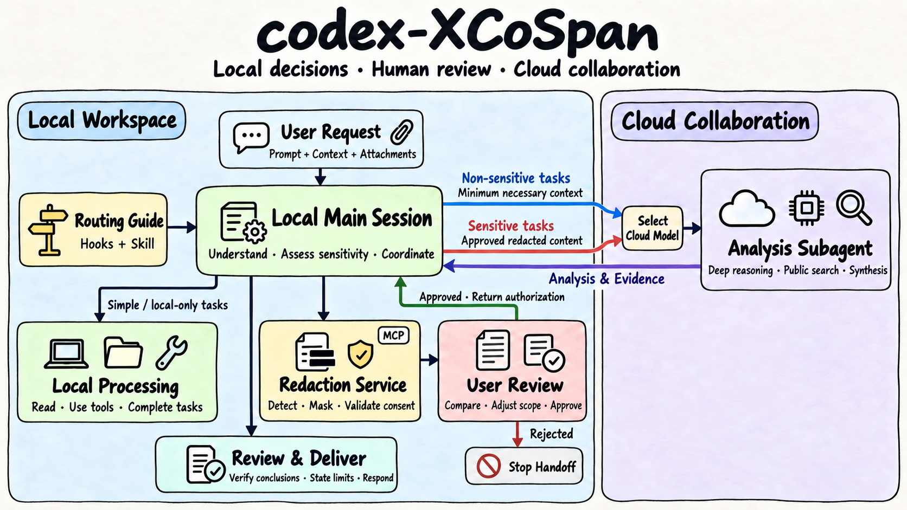

# codex-XCoSpan

[English](README.md) · [简体中文](README.zh-CN.md)

A Codex plugin that coordinates a locally deployed main-session model with cloud analysis. Simple work stays local; complex sensitive material is redacted and reviewed by you before the plugin prepares a cloud handoff.

The plugin appears as **Edge-Cloud Collaboration**. Its installation ID is `codex-local-privacy-router`.

## Before you start

- Use the Codex desktop app for direct ZIP installation.
- Install Node.js 20+ so the app can run the plugin's local service. Desktop ZIP installation does not require the Codex CLI.
- Configure a locally deployed main-session model **before submitting private material**. Installing this plugin does not install a model, change where your chat runs, or make an existing cloud chat local.

## Install

For published versions, download `codex-local-privacy-router-<version>.zip` from this repository's **Releases** page. **Only the ZIP is needed to install.** The `.zip.sha256` file is optional, for checking download integrity. GitHub's automatic **Source code (zip)** is the source archive. To build a package locally, see [Contributing](CONTRIBUTING.md#build-a-package-locally).

**Recommended: import the ZIP directly in Codex desktop.**

1. Open plugin management in the desktop app and select the downloaded plugin ZIP for import.
2. Check the installed name **Edge-Cloud Collaboration** and its version, enable the plugin, and review and trust its Hooks as required.
3. Start a new chat to use it.

The ZIP includes the built UI and runtime files; no extraction, `npm install`, or Python is needed for desktop import. Uploading the ZIP into an ordinary chat does not install it. For a command-line alternative, extract the ZIP into a dedicated directory and run `node install.mjs`; only this route requires a Codex CLI with plugin commands. See the [installation guide](docs/installation.md) (中文) for checksums, updates, and the CLI alternative.

## Use it

Submit your task normally. You can mention **Edge-Cloud Collaboration** in the first request; once its Hooks are active, you do not need to repeat the name on every turn.

> Use Edge-Cloud Collaboration to compare the risks in this synthetic supplier proposal. Show me the redacted version before any cloud analysis.

| Your task | What to expect |
| --- | --- |
| Simple work | The local main session answers directly. |
| Complex work using non-sensitive material | The main session selects an eligible cloud model and delegates the analysis. No redaction review is needed. |
| Complex work containing sensitive material | The main session creates a local redaction preview and waits for your confirmation. |

On first use, confirm where the main-session model runs. When several eligible cloud models are available, choose one; this choice is separate from approving a redacted document.

For a redaction review, select **Compare redaction**, check the full text, and mask anything missed. Choose **Confirm and continue** to authorize that version, or **Reject and stop** to stop the handoff. Confirmation saves your decision; the main session then dispatches the analysis and returns the result. Changed content needs another review. To keep a task local, say: “Handle this task locally; do not use cloud analysis.”

The [usage guide](docs/usage.md) (中文) walks through examples, corrections, confirmation, and recovery when a preview expires or the UI cannot resume the chat.

## Privacy boundary

The default detector runs offline. An optional configured detection service receives original text chunks. Cloud analysis through the sensitive workflow receives the confirmed redacted material and checked task instructions. The plugin does not control unrelated host tools or the host's own storage, and redaction can miss sensitive meaning. Read the [data flow and limitations](docs/privacy.md) (中文).

## Documentation and development

| Document | Purpose |
| --- | --- |
| [Installation](docs/installation.md) · [Usage](docs/usage.md) | Setup and everyday operation (中文) |
| [Configuration](docs/configuration.md) | Optional dictionary, rules, and detection service (中文) |
| [Architecture](docs/architecture.md) | Modules, workflow, and compatibility entry points (中文) |
| [Contributing](CONTRIBUTING.md) | Build, test, and release checks |
| [Routing reference](skills/privacy-routing/references/routing-policy.md) | Agent-facing protocol and authorization rules |
| [Security](SECURITY.md) · [Changelog](CHANGELOG.md) | Vulnerability reporting and release history |

Licensed under [MIT](LICENSE).
