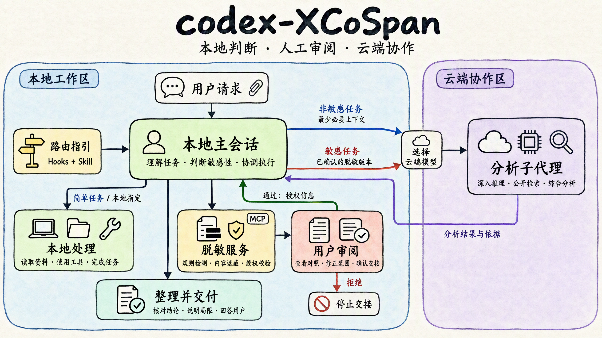

# codex-XCoSpan

[](https://github.com/XHToken/codex-XCoSpan/actions/workflows/ci.yml)
[](https://github.com/XHToken/codex-XCoSpan/releases/latest)
[](https://nodejs.org/)
[](https://github.com/XHToken/community/blob/main/LICENSE)
[](https://discord.gg/yxesrcfy7)

[English](README.md) · [简体中文](README.zh-CN.md)

让本地主会话模型与云端分析模型协作的 Codex 插件：简单任务留在本地；复杂任务涉及敏感材料时，先在本地脱敏，由你确认后再准备云端交接。

客户端显示名称为 **Edge-Cloud Collaboration**，安装标识为 `codex-local-privacy-router`。



## 使用前准备

- 本机安装 Node.js 20+，供插件运行本地服务。
- 使用 Codex 桌面端；通过命令行安装时，还需支持 `plugin` 命令的 Codex CLI。
- **提交私密材料前，先在宿主中配置本地部署的主会话模型。** 安装本插件不会部署模型、切换当前模型，也不会把已有的云端聊天变成本地聊天。

## 安装

**[下载插件 ZIP · v0.1.0](https://github.com/XHToken/codex-XCoSpan/releases/download/v0.1.0/codex-local-privacy-router-0.1.0.zip)** · [所有版本](https://github.com/XHToken/codex-XCoSpan/releases)

选择一种方式即可：

| 方式 | 适用场景 | 操作 |
| --- | --- | --- |
| Git 插件市场（推荐） | 由 Codex 自动获取和安装 | 添加仓库市场，执行插件安装命令 |
| 桌面端导入 ZIP | 通过桌面端安装发布版本 | 下载 ZIP，在插件管理中导入 |
| 命令行安装 ZIP | 习惯使用终端，或客户端没有 ZIP 导入入口 | 解压 ZIP，运行 `node install.mjs` |
| 从源码安装 | 修改插件或使用仓库中的版本 | 克隆仓库，运行安装脚本 |

### 方式一：Git 插件市场

准备 Git、Node.js 20+ 和支持插件命令的 Codex CLI，运行：

```sh
codex plugin marketplace add XHToken/codex-XCoSpan
codex plugin add codex-local-privacy-router@codex-xcospan
```

Codex 会自动获取仓库并安装插件，无需手动下载 ZIP 或克隆源码。安装后在客户端启用 **Edge-Cloud Collaboration**，按提示审阅并信任 Hooks，打开新聊天。

### 方式二：桌面端导入 ZIP

1. 下载上方的 `codex-local-privacy-router-0.1.0.zip`。
2. 打开 Codex 桌面端的插件管理页面，通过 ZIP 导入入口选择该文件。ZIP 已包含构建好的界面和运行文件，无需解压。
3. 安装后启用 **Edge-Cloud Collaboration**，按提示审阅并信任 Hooks，然后打开新聊天。

### 方式三：命令行安装 ZIP

先确认 Codex CLI 支持插件命令：

```sh
codex plugin --help
```

将插件 ZIP 完整解压到独立目录，保留 `.codex-plugin/` 等隐藏文件。在包含 `install.mjs` 的目录打开终端，运行：

```sh
node install.mjs
```

脚本会复制插件、注册本地市场并完成安装。随后在客户端启用插件、信任 Hooks，打开新聊天。

### 方式四：从源码安装

准备 Git、Node.js 20+ 和支持插件命令的 Codex CLI，运行：

```sh
git clone https://github.com/XHToken/codex-XCoSpan.git
cd codex-XCoSpan
node install.mjs
```

仓库已包含构建好的界面。安装后在客户端启用插件、信任 Hooks，打开新聊天。修改并重新构建界面或生成可分发的 ZIP，见[贡献指南](CONTRIBUTING.md)；安装验证、更新和排障见[安装指南](docs/zh-CN/installation.md)。

## 怎么使用

直接用自然语言提交任务即可。首次可以提及 **Edge-Cloud Collaboration**；Hooks 正常启用后，后续消息不需要反复点名插件。

> 请使用 Edge-Cloud Collaboration 分析这份虚构的供应商方案，比较履约风险。如需云端分析，请先让我确认脱敏版本。

| 任务类型 | 你会看到什么 |
| --- | --- |
| 简单任务 | 本地主会话直接回答。 |
| 复杂、非敏感任务 | 选择可用的云端模型后交给子代理分析，无需脱敏确认。 |
| 复杂、敏感任务 | 先生成本地脱敏预览，等待你确认。 |

首次使用时按提示确认主会话的实际部署位置。有多个合适的云端模型时，再选择使用哪一个；**选择模型与确认脱敏内容是两件事**。

出现预览后，点击“**查看脱敏对照**”核对全文，补充遮蔽遗漏的敏感内容；同意后点击“**确认并继续**”，不同意则点击“**拒绝并停止**”。确认保存授权后，主会话才会调度云端分析并返回结果。材料修改后需要重新确认。

如果只希望本地处理，直接说：“**这次只在本地完成，不要使用云端分析。**”

完整示例、误遮蔽修正、预览过期和确认后未继续的处理方式见[使用指南](docs/zh-CN/usage.md)。

## 隐私边界

默认规则检测离线运行；可选的独立检测服务会接收原文分块。敏感工作流只向云端分析交接已确认的脱敏材料和检查后的任务说明。插件不能控制宿主的其他工具或记录方式，脱敏也可能漏掉敏感语义。详见[数据流与隐私边界](docs/zh-CN/privacy.md)。

## 文档导航

| 文档 | 内容 |
| --- | --- |
| [安装指南](docs/zh-CN/installation.md) | 环境、安装、验证、更新与排障 |
| [使用指南](docs/zh-CN/usage.md) | 提交任务、查看对照、修正、确认与继续 |
| [检测配置](docs/zh-CN/configuration.md) | 可选企业词表、自定义规则与检测服务 |
| [架构说明](docs/zh-CN/architecture.md) | 模块职责、工作流与兼容入口 |
| [贡献指南](CONTRIBUTING.md) | 开发、测试和发布检查 |
| [路由参考](skills/privacy-routing/references/routing-policy.md) | 面向代理的协议与授权规则 |
| [安全报告](SECURITY.md) · [更新记录](CHANGELOG.md) | 漏洞报告与版本历史 |

本项目采用 [XHToken community 许可证（Apache-2.0）](LICENSE)。
