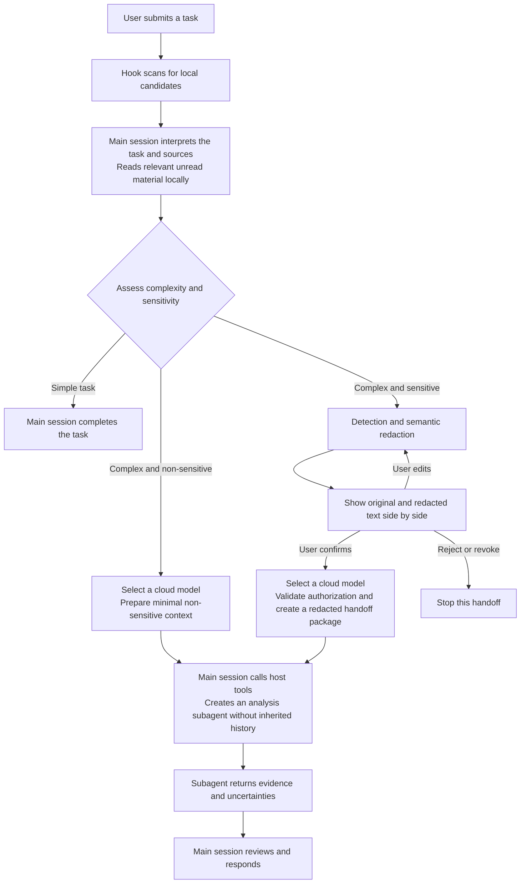

# Architecture and maintenance

[Home](../README.md) · [简体中文](zh-CN/architecture.md)

The plugin consists of agent instructions, Hooks, a Node.js MCP server, and a confirmation UI. The main session interprets the task and calls the host's subagent tools. The MCP server handles detection, redaction state, and handoff validation; it does not launch cloud models itself.

See the [usage guide](usage.md) for operating steps and [privacy and data flow](privacy.md) for deployment boundaries. The [routing protocol reference](../skills/privacy-routing/references/routing-policy.md) is the implementation reference for tool fields, offset rules, and call constraints.

## Provider boundary and Exec alternative

On `main`, native subagents inherit the main session's provider even when their model IDs differ. Local-main/cloud-subagent deployments therefore need a third-party gateway that routes both models behind one provider/base URL and exposes the Responses API. The MCP server does not configure providers or translate inference protocols. See [model connection requirements](configuration.md#model-providers-and-api-protocol).

The [`exec` branch](https://github.com/XHToken/codex-XCoSpan/tree/exec) replaces the native subagent with a separate `codex exec` process. Each process can use its own provider/base URL and credentials; each model endpoint must still be Responses-compatible. Use the [Exec installation steps](installation.md#install-the-exec-alternative) for that implementation. The branches evolve independently.

## Module responsibilities

| Path | Responsibility |
| --- | --- |
| `skills/privacy-routing/SKILL.md` | Main-session workflow and constraints on model selection, user confirmation, and result collection. |
| `skills/privacy-routing/references/routing-policy.md` | Protocols for routing, redaction revisions, authorization, and handoff. |
| `hooks/`, `hooks.json` | Session-start guidance, local candidate scanning on each submission, and host role detection; no attachment reads or model calls. |
| `mcp/server.mjs` | stdio MCP entry point, tool definitions, preview state, redaction revisions, authorization checks, and UI resources. |
| `mcp/routing.mjs` | Routing decisions and format-based candidate matching; receives semantic assessments from the main session. |
| `mcp/detection*.mjs` | Detection configuration, a worker thread for rules and enterprise dictionaries, and an optional model detection service. |
| `mcp/subagent-policy.mjs` | Subagent role instructions shared by both cloud handoff paths. |
| `shared/messages.mjs` | Language detection and UI text shared by MCP and the UI. |
| `ui/src/`, `ui/review.template.html` | Confirmation UI source; built into `ui/contract-redaction-review.html`, which is loaded at runtime. |
| `config/` | Synthetic detection configuration examples; actual enterprise configuration belongs outside the plugin directory. |
| `scripts/`, `tests/` | Builds, validation, and automated tests; see the [contributing guide](../CONTRIBUTING.md) for the development workflow. |
| `install.mjs` | Creates a local plugin marketplace and invokes the Codex installation command. |

## Data and control flow

For research using public sources, the main session can give the research objective directly to a subagent to search. Material that must be read first includes user-provided material relevant to the task, private content, and content of unknown origin. Respect an explicit user choice to process the task locally.

Default detection runs only local rules and dictionaries; semantic judgments come from the main session. When a separate detection endpoint is enabled, the detection module sends chunks of the original text to that endpoint. See [detection configuration](configuration.md) for the requirements.

## State and authorization constraints

The normal preview path is `awaiting_confirmation → confirmed → handed_off`; it can also enter `rejected` or `revoked`. Preserve these invariants during maintenance:

- Previews and model selections are held only in the MCP process. Both expire after 30 minutes and are not restored after a restart.
- Authorization is bound to the current redacted content and detection policy. Actual edits clear confirmation and the token; operations that leave content unchanged preserve authorization. Policy changes require a new preview.
- Confirmation creates a single-use token. Handoff checks the revision, model selection, and authorization state after asynchronous detection, then consumes the token. `handed_off` means only that the package has been generated; the main session still creates the subagent and waits for its result.
- Cloud model selection is independent of redaction confirmation. Multiple candidates require a user choice; if no suitable model is available, cloud analysis stops. Model capabilities and deployment information come from the host and user confirmation; the plugin cannot verify them independently.

Rule detection and tool validation cannot prove that semantic redaction is complete. Host execution still depends on the main session following its instructions. See the [routing protocol implementation reference](../skills/privacy-routing/references/routing-policy.md) for call parameters, subagent roles, and forwarding boundaries.

## Manifests and stable entry points

| File | Purpose |
| --- | --- |
| `.codex-plugin/plugin.json`, `.mcp.json` | Codex plugin manifest and MCP configuration; use relative entry points within the plugin directory. |
| `plugin.json`, `mcp.json` | Compatibility manifests; preserve the standard schemas, extension structure, and `${PLUGIN_ROOT}` path notation. |
| `hooks.json` | Hook declarations shared by both manifest formats, executing Node.js entry points directly. |
| `package.json` | Source of shared metadata such as name and version; the MCP server and UI build read the version from this file. |

Both manifest formats share the name, version, and description, but differ in structure and path notation. Do not simply merge them. Synchronize the manifests and run project validation when changing release metadata.

The repository is named `codex-XCoSpan`; the installation identifier remains `codex-local-privacy-router`. Preserve `mcp/server.mjs`, the Hook entry points, and the `ui://codex-local-privacy-router/contract-redaction-review.html` resource URI. After changing the UI source, rebuild the runtime HTML as described in the [contributing guide](../CONTRIBUTING.md).
