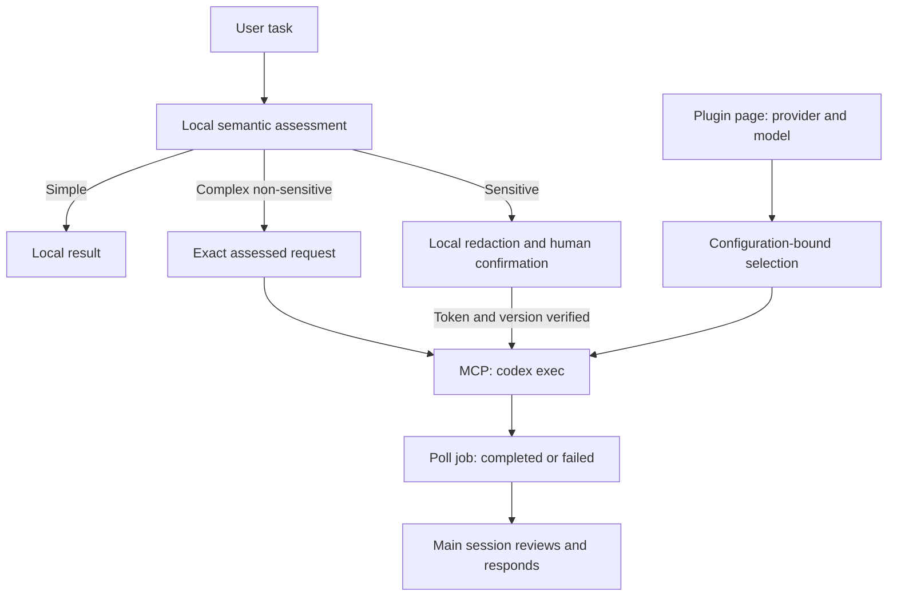

# Architecture and maintenance

[Home](../README.md) · [简体中文](zh-CN/architecture.md)

The plugin consists of agent instructions, Hooks, a Node.js MCP server, and a confirmation UI. The main session interprets the task. MCP manages detection, consent, saved cloud settings and asynchronous codex exec jobs.

See the [usage guide](usage.md) for operating steps and [privacy and data flow](privacy.md) for deployment boundaries. The [routing protocol reference](../skills/privacy-routing/references/routing-policy.md) is the implementation reference for tool fields, offset rules, and call constraints.

## Module responsibilities

| Path | Responsibility |
| --- | --- |
| `skills/privacy-routing/SKILL.md` | Main-session workflow and constraints on model selection, user confirmation, and result collection. |
| `skills/privacy-routing/references/routing-policy.md` | Protocols for routing, redaction revisions, authorization, and handoff. |
| `hooks/`, `hooks.json` | Session-start guidance, local candidate scanning on each submission, and host role detection; no attachment reads or model calls. |
| `mcp/server.mjs` | stdio MCP entry point, tool definitions, preview state, redaction revisions, authorization checks, and UI resources. |
| `mcp/routing.mjs` | Routing decisions and format-based candidate matching; receives semantic assessments from the main session. |
| `mcp/detection*.mjs` | Detection configuration, a worker thread for rules and enterprise dictionaries, and an optional model detection service. |
| `mcp/subagent-policy.mjs` | Host subagent exemption for plugin hooks; cloud execution is in `cloud-exec.mjs`. |
| `mcp/cloud-config.mjs` | Validate and atomically persist provider/model settings. |
| `mcp/cloud-exec.mjs` | Isolated CLI invocation, timeout, output bounds and cleanup. |
| `mcp/cloud-policy.mjs` | Instructions for public and sanitized cloud jobs. |
| `shared/messages.mjs` | Language detection and UI text shared by MCP and the UI. |
| `ui/src/`, `ui/review.template.html` | Confirmation UI source; built into `ui/contract-redaction-review.html`, which is loaded at runtime. |
| `config/` | Synthetic detection configuration examples; actual enterprise configuration belongs outside the plugin directory. |
| `scripts/`, `tests/` | Builds, validation, and automated tests; see the [contributing guide](../CONTRIBUTING.md) for the development workflow. |
| `install.mjs` | Creates a local plugin marketplace and invokes the Codex installation command. |

## Data and control flow

The direct route stores exact assessed input in a 30-minute request handle; repeated submissions return the same job. The sensitive path validates the review, checked task, token, sanitized hash, detection policy and selected cloud configuration again after asynchronous detection before consuming consent. Only canonical sanitized text enters the CLI. Public jobs permit provider web search; sensitive jobs disable it.

State: `awaiting_confirmation → confirmed → running → completed|failed`, with rejection/revocation before transmission. Running/completed versions cannot be reconfirmed. Failed sensitive jobs require new consent; retries never occur automatically. Preview/selection/request state is in memory for 30 minutes. Completed results remain for 30 minutes after completion. Restart loses this state. Saved provider/model configuration persists separately; each job snapshots it, and configuration changes invalidate unused selection handles.

The CLI receives an argument array (`shell:false`) and payload through stdin. A temporary home excludes inherited plugins, MCP, history and user settings. Only required credentials are copied. Workers use `danger-full-access` with no approval prompts, enable shell tools and retain other built-in tool defaults; hooks, apps and multi-agent delegation are disabled. The temporary directory separates state but is not a filesystem/network boundary. Hosted search still depends on provider/model/runtime support; public workers may retrieve public sources through shell networking. Timeout kills the process group on POSIX; output is bounded, diagnostics suppressed, and temporary directories removed on completion. This does not control unrelated host tools or prove semantic redaction complete.

## Manifests and stable entry points

| File | Purpose |
| --- | --- |
| `.codex-plugin/plugin.json`, `.mcp.json` | Codex plugin manifest and MCP configuration; use relative entry points within the plugin directory. |
| `plugin.json`, `mcp.json` | Compatibility manifests; preserve the standard schemas, extension structure, and `${PLUGIN_ROOT}` path notation. |
| `hooks.json` | Hook declarations shared by both manifest formats, executing Node.js entry points directly. |
| `package.json` | Source of shared metadata such as name and version; the MCP server and UI build read the version from this file. |

Both manifest formats share the name, version, and description, but differ in structure and path notation. Do not simply merge them. Synchronize the manifests and run project validation when changing release metadata.

The repository is named `codex-XCoSpan`; the installation identifier remains `codex-local-privacy-router`. Preserve `mcp/server.mjs`, the Hook entry points, and the `ui://codex-local-privacy-router/contract-redaction-review.html` resource URI. After changing the UI source, rebuild the runtime HTML as described in the [contributing guide](../CONTRIBUTING.md).
