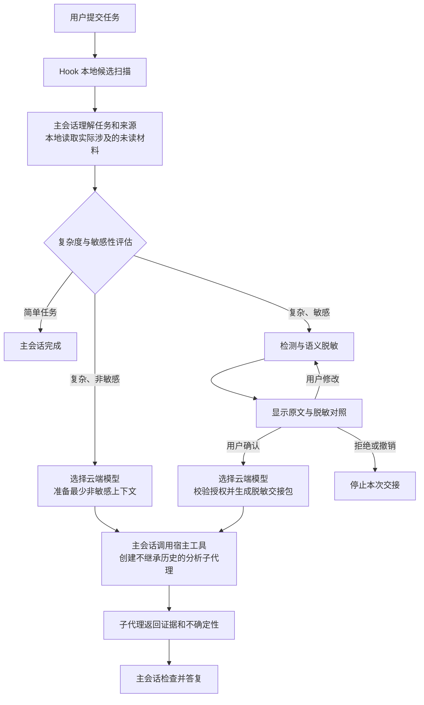

# 架构与维护入口

[主页](../../README.zh-CN.md) · [English](../architecture.md)

插件由代理指令、Hooks、Node.js MCP 服务和确认界面组成。主会话负责理解任务和调用宿主的子代理工具；MCP 服务负责检测、脱敏状态与交接校验，不自行启动云端模型。

使用步骤见[使用指南](usage.md)，部署边界见[隐私与数据流](privacy.md)。工具字段、偏移规则和调用约束统一以[路由协议参考](../../skills/privacy-routing/references/routing-policy.md)为准；该英文协议是实现参考。

## 供应商边界与 Exec 替代方案

`main` 的原生 subagent 即使选择不同模型 ID，也会继承主会话的供应商。因此，“本地主会话 + 云端 subagent”需要第三方网关将两类模型路由到统一供应商入口，并提供 Responses API 协议。MCP 服务不配置供应商，也不转换推理协议。详见[模型接入要求](configuration.md#模型供应商与-api-协议)。

[`exec` 分支](https://github.com/XHToken/codex-XCoSpan/tree/exec)将原生 subagent 替换为独立的 `codex exec` 进程；两个进程可分别使用不同供应商、接口地址和鉴权，但各自的模型端点仍须兼容 Responses API。需要该实现时，按 [Exec 安装步骤](installation.md#安装-exec-替代方案)安装。两个分支独立迭代。

## 模块职责

| 路径 | 职责 |
| --- | --- |
| `skills/privacy-routing/SKILL.md` | 主会话执行流程，以及模型选择、人工确认和结果回收约束。 |
| `skills/privacy-routing/references/routing-policy.md` | 路由、脱敏修订、授权和交接协议。 |
| `hooks/`、`hooks.json` | 会话启动指引、每次提交的本地候选扫描和宿主角色识别；不读取附件或调用模型。 |
| `mcp/server.mjs` | stdio MCP 入口、工具定义、预览状态、脱敏修订、授权校验与 UI 资源。 |
| `mcp/routing.mjs` | 路由判断和格式候选匹配；接收主会话给出的语义评估。 |
| `mcp/detection*.mjs` | 检测配置、规则和企业词表工作线程，以及可选模型检测服务。 |
| `mcp/subagent-policy.mjs` | 两种云端交接共用的子代理角色指令。 |
| `shared/messages.mjs` | MCP 与 UI 共用的语言识别和界面文案。 |
| `ui/src/`、`ui/review.template.html` | 确认界面源码；构建为运行时读取的 `ui/contract-redaction-review.html`。 |
| `config/` | 合成检测配置示例；实际企业配置放在插件目录之外。 |
| `scripts/`、`tests/` | 构建、校验及自动化测试；开发流程见[贡献指南](../../CONTRIBUTING.md)。 |
| `install.mjs` | 创建本地插件市场并调用 Codex 安装命令。 |

## 数据与控制流

公开资料研究可直接把研究目标交给子代理检索；需要先读取的是本次任务涉及的用户材料或私有、来源不明的内容。用户明确选择本地处理时，遵循该选择。

默认检测只运行本地规则和词表，语义判断来自主会话。启用独立检测端点后，检测模块会向该端点发送原文分块；配置要求见[检测配置](configuration.md)。

## 状态与授权约束

预览的正常路径是 `awaiting_confirmation → confirmed → handed_off`，也可以进入 `rejected` 或 `revoked`。维护时保留以下不变量：

- 预览和模型选择仅保存在 MCP 进程内，均有效 30 分钟，重启后不恢复。
- 授权绑定当前脱敏内容和检测策略。实际修改清除确认与 token；未变操作保留授权；策略改变必须重新生成预览。
- 确认产生一次性 token。交接校验版本、模型选择及异步检测后的授权状态，再消费 token。`handed_off` 只表示包已生成，创建子代理和等待结果仍由主会话执行。
- 云端模型选择与脱敏确认独立；多个候选需用户选择，没有合适模型则停止云端分析。模型能力和部署信息来自宿主及用户确认，插件不能独立验证。

规则检测与工具校验不能证明语义脱敏完整性，宿主执行仍依赖主会话遵守指令。调用参数、子代理角色与转发边界见[路由协议参考（英文实现参考）](../../skills/privacy-routing/references/routing-policy.md)。

## 清单与稳定入口

| 文件 | 用途 |
| --- | --- |
| `.codex-plugin/plugin.json`、`.mcp.json` | Codex 插件清单及其 MCP 配置；使用插件目录内的相对入口。 |
| `plugin.json`、`mcp.json` | 兼容清单；保留标准 schema、扩展结构及 `${PLUGIN_ROOT}` 路径表达。 |
| `hooks.json` | 两套清单共享的 Hook 声明，直接执行 Node.js 入口。 |
| `package.json` | 名称、版本等公共元数据来源；MCP 服务和 UI 构建从中读取版本。 |

两套清单共享名称、版本与说明，但结构和路径表达不同，不应简单合并。修改发布元数据时同步清单并执行项目校验。

仓库名为 `codex-XCoSpan`，安装标识保持 `codex-local-privacy-router`。保留 `mcp/server.mjs`、Hook 入口及 `ui://codex-local-privacy-router/contract-redaction-review.html` 资源 URI。修改界面源码后，按[贡献指南](../../CONTRIBUTING.md)重新构建运行时 HTML。
