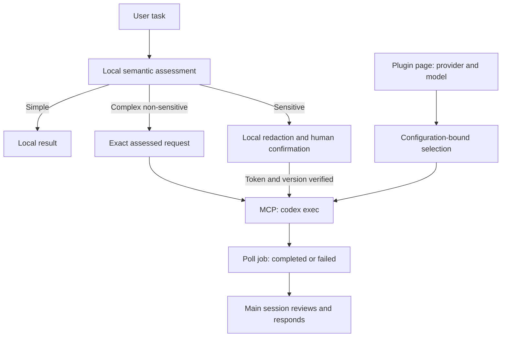

# 架构与维护入口

[主页](../../README.zh-CN.md) · [English](../architecture.md)

插件由代理指令、Hooks、Node.js MCP 服务和确认界面组成。主会话理解任务；MCP 服务负责检测、授权、云端配置和异步 codex exec 执行。

使用步骤见[使用指南](usage.md)，部署边界见[隐私与数据流](privacy.md)。工具字段、偏移规则和调用约束统一以[路由协议参考](../../skills/privacy-routing/references/routing-policy.md)为准；该英文协议是实现参考。

## 模块职责

| 路径 | 职责 |
| --- | --- |
| `skills/privacy-routing/SKILL.md` | 主会话执行流程，以及模型选择、人工确认和结果回收约束。 |
| `skills/privacy-routing/references/routing-policy.md` | 路由、脱敏修订、授权和交接协议。 |
| `hooks/`、`hooks.json` | 会话启动指引、每次提交的本地候选扫描和宿主角色识别；不读取附件或调用模型。 |
| `mcp/server.mjs` | stdio MCP 入口、工具定义、预览状态、脱敏修订、授权校验与 UI 资源。 |
| `mcp/routing.mjs` | 路由判断和格式候选匹配；接收主会话给出的语义评估。 |
| `mcp/detection*.mjs` | 检测配置、规则和企业词表工作线程，以及可选模型检测服务。 |
| `mcp/subagent-policy.mjs` | 宿主子代理遇到 Hook 时的豁免指令；云端执行由 `cloud-exec.mjs` 完成。 |
| `mcp/cloud-config.mjs` | 校验并原子保存供应商/模型配置。 |
| `mcp/cloud-exec.mjs` | 隔离调用 CLI、超时、输出限制和清理。 |
| `mcp/cloud-policy.mjs` | 公开研究与脱敏任务的云端指令。 |
| `shared/messages.mjs` | MCP 与 UI 共用的语言识别和界面文案。 |
| `ui/src/`、`ui/review.template.html` | 确认界面源码；构建为运行时读取的 `ui/contract-redaction-review.html`。 |
| `config/` | 合成检测配置示例；实际企业配置放在插件目录之外。 |
| `scripts/`、`tests/` | 构建、校验及自动化测试；开发流程见[贡献指南](../../CONTRIBUTING.md)。 |
| `install.mjs` | 创建本地插件市场并调用 Codex 安装命令。 |

## 数据与控制流

直接云端路径将准确的已评估输入保存在有效 30 分钟的请求句柄中，重复提交返回同一个任务。敏感路径在异步检测后再次验证预览、任务说明、token、脱敏哈希、检测策略和供应商配置，然后消费授权。CLI 只接收规范脱敏正文。公开研究允许供应商网页搜索，敏感任务关闭搜索。

状态：`awaiting_confirmation → confirmed → running → completed|failed`，发送前可拒绝/撤销。运行中或已完成版本不可重新确认。失败的敏感任务重试需新授权，不自动重试。预览、选择和请求状态在内存中有效 30 分钟；结果完成后保留 30 分钟，重启丢失。供应商/模型配置独立持久化，每个任务使用启动时的快照，配置变更使未使用的选择句柄失效。

CLI 使用参数数组（`shell:false`）和标准输入传递任务，临时用户目录不继承插件、MCP、历史和用户设置，只复制所需凭据。使用 `danger-full-access` 且无需审批，启用 shell，其他内置工具保留 CLI 默认配置；关闭 Hooks、应用和多代理委派。临时目录只分离状态，不限制文件系统和网络。托管搜索仍取决于供应商、模型及运行时支持；公开任务可以通过 shell 联网获取公开资料。超时在 POSIX 终止进程组，限制输出，隐藏原始诊断，结束后清理目录。此机制不控制宿主其他工具，也不证明语义脱敏完整。

## 清单与稳定入口

| 文件 | 用途 |
| --- | --- |
| `.codex-plugin/plugin.json`、`.mcp.json` | Codex 插件清单及其 MCP 配置；使用插件目录内的相对入口。 |
| `plugin.json`、`mcp.json` | 兼容清单；保留标准 schema、扩展结构及 `${PLUGIN_ROOT}` 路径表达。 |
| `hooks.json` | 两套清单共享的 Hook 声明，直接执行 Node.js 入口。 |
| `package.json` | 名称、版本等公共元数据来源；MCP 服务和 UI 构建从中读取版本。 |

两套清单共享名称、版本与说明，但结构和路径表达不同，不应简单合并。修改发布元数据时同步清单并执行项目校验。

仓库名为 `codex-XCoSpan`，安装标识保持 `codex-local-privacy-router`。保留 `mcp/server.mjs`、Hook 入口及 `ui://codex-local-privacy-router/contract-redaction-review.html` 资源 URI。修改界面源码后，按[贡献指南](../../CONTRIBUTING.md)重新构建运行时 HTML。
